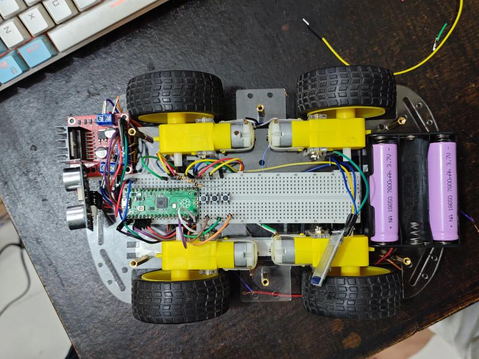
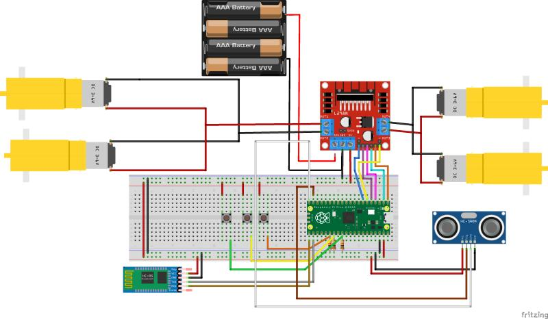
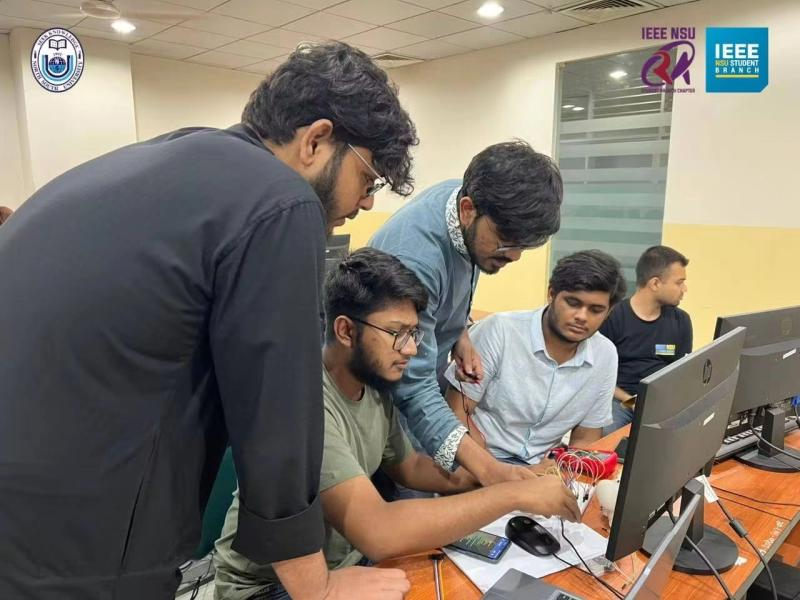

# Mahathir Neloy

**Electrical and Electronic Engineering student at North South University (NSU), Dhaka.**
Robotics and embedded systems: Raspberry Pi Pico, ESP8266, motors, sensors, and a lot of debugging.

[**Open the portfolio**](https://mahathirjneloy.github.io/) · [LinkedIn](https://www.linkedin.com/in/mahathir-neloy) · [Facebook](https://www.facebook.com/mahathirjneloy)

---

## Free tools and guides for NSU students

| Page | What it does |
|---|---|
| [NSU CGPA calculator](https://mahathirjneloy.github.io/nsu.html) | Work out your CGPA, including retakes |
| [NSU grading system and retake policy](https://mahathirjneloy.github.io/nsu-grading.html) | Type your marks to get your grade. Retake, probation, add and drop rules |
| [NSU Code of Conduct penalties](https://mahathirjneloy.github.io/nsu-code-of-conduct.html) | Search 67 rules and see the 1st, 2nd and 3rd penalty |
| [NSU student guide](https://mahathirjneloy.github.io/infos.html) | Quick answers, routines and notices |

Unofficial student summaries, not NSU pages. Confirm with NSU before you act.

---

## Featured project: Bluetooth RC car with autonomous obstacle avoidance

Built with a 3-member team in the IEEE NSU RAS "RC Car with Raspberry Pi Pico" workshop series.

- **Powertrain:** two DC gear-motor pairs on an L298N H-bridge, driven by RP2040 PWM in MicroPython
- **Control:** manual drive over Bluetooth with an HC-05 module (F, B, L, R, S bytes)
- **Two modes:** RC and Autonomous, switchable on the fly
- **Avoidance:** HC-SR04 ultrasonic echo timing (voltage divided to 3.3 V) plus side IR sensors. It stops, steers away and resumes

| Hardware | Wiring | Workshop |
|---|---|---|
|  |  |  |

---

## Tools

- **Firmware:** MicroPython (Thonny), Arduino IDE
- **Simulation and design:** MATLAB, Multisim, EasyEDA, Fritzing
- **Boards:** Raspberry Pi Pico (RP2040), ESP8266

## Leadership

- **IEEE NSU Student Branch:** core volunteer, logistics and operations (member since Oct 2025)
- **WIE and PES chapters:** core volunteer, logistics and operations
- **IAS chapter:** core volunteer, PR and membership development
- **NoobLab:** founder of a 3-member robotics team competing in LFR (Line Following Robot), aiming to be the top LFR team in Bangladesh

## Open to

Internships, research collaboration, and engineering discussions in robotics, microcontrollers and circuit simulation. Message me on [LinkedIn](https://www.linkedin.com/in/mahathir-neloy).
